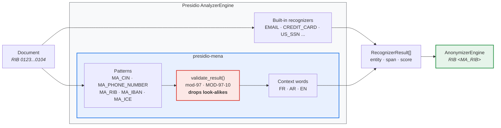

<div align="center">

# presidio-mena

**Moroccan and MENA identifier recognizers for [Microsoft Presidio](https://github.com/microsoft/presidio) — with check-digit validation.**

[](https://github.com/novagiosAI/presidio-mena/actions/workflows/ci.yml)
[](https://pypi.org/project/presidio-mena/)
[](https://pypi.org/project/presidio-mena/)
[](LICENSE)
[](https://peps.python.org/pep-0561/)

*Drop-in. Two lines to install, one line to register.*

</div>

---

## Why

Presidio ships recognizers for US, UK, Spanish, Italian, Indian, Singaporean and
Australian identifiers. It ships none for the Maghreb. If you run Presidio over
Moroccan documents today, a national ID card number, a bank account or a company
identifier passes straight through.

This package adds them, following Presidio's own conventions so nothing else in
your pipeline has to change.

| Entity | Identifier | Validation |
|---|---|---|
| `MA_CIN` | National identity card (CIN / CNIE) | placeholder rejection |
| `MA_PHONE_NUMBER` | Mobile and landline | placeholder rejection |
| `MA_RIB` | Bank account, 24 digits | ✅ **mod-97 check key** |
| `MA_IBAN` | Moroccan IBAN | ✅ **ISO 7064 MOD-97-10** |
| `MA_ICE` | Company identifier, 15 digits | placeholder rejection |

## Installation

```bash
pip install presidio-mena
```

## Usage

```python
from presidio_analyzer import AnalyzerEngine
from presidio_mena import register_mena_recognizers

analyzer = AnalyzerEngine()
register_mena_recognizers(analyzer)

text = "Client BE12345, tel 0612345678, RIB 012345678901234567890104"
results = analyzer.analyze(text, language="en")

for result in sorted(results, key=lambda r: r.start):
    print(f"{result.entity_type:<18} {result.score}")
# MA_CIN             0.5
# US_DRIVER_LICENSE  0.3     <- built-in, outranked
# MA_PHONE_NUMBER    0.85    <- raised by the context word "tel"
# PHONE_NUMBER       0.4     <- built-in, outranked
# US_BANK_NUMBER     0.05
# MA_RIB             1.0     <- check key confirmed
```

Presidio's own recognizers still fire on the same spans — that is normal, and
the highest score wins. Because the MENA recognizers are country-specific and
checksum-validated, they outrank the generic ones on Moroccan data.

It composes with the rest of Presidio exactly as you would expect:

```python
from presidio_anonymizer import AnonymizerEngine

anonymized = AnonymizerEngine().anonymize(text=text, analyzer_results=results)
print(anonymized.text)
# Client <MA_CIN>, tel <MA_PHONE_NUMBER>, RIB <MA_RIB>
```

Registering for several languages, or into a hand-built registry:

```python
from presidio_analyzer import RecognizerRegistry
from presidio_mena import register_mena_recognizers, mena_recognizers

registry = RecognizerRegistry()
registry.load_predefined_recognizers()
register_mena_recognizers(registry, languages=["en", "fr"])

# or take the instances and wire them yourself
for recognizer in mena_recognizers(supported_language="fr"):
    registry.add_recognizer(recognizer)
```

Individual recognizers can be used on their own, and every parameter Presidio
exposes — patterns, context words, entity name — can be overridden:

```python
from presidio_mena import MoroccanRIBRecognizer

recognizer = MoroccanRIBRecognizer(supported_entity="BANK_ACCOUNT_MA")
```

## The check digit is the point

A pattern alone cannot distinguish a bank account from an asset tag: both are
just digits. So the RIB and IBAN recognizers score their pattern *low*, then
Presidio calls `validate_result()`, which runs the real checksum:

- a **confirmed** value is raised to full confidence;
- a value that **fails** the checksum is discarded entirely.

In practice, of 200 arbitrary 24-digit numbers, at least 190 are correctly
rejected — only about 1 in 97 can carry a valid key. Your inventory references
survive an anonymization pass; the bank details do not.



## Multilingual context

Moroccan documents mix French, Arabic and English in the same paragraph, so the
context words that boost a score do too — `rib`, `compte`, `banque`, `حساب`,
`account`. A CIN found next to *carte nationale* scores higher than the same
string found alone.

Presidio's context enhancer compares single token lemmas, so every context entry
is one word; multi-word phrases would never match.

## Limitations

- **CIN and ICE have no publicly specified check digit**, so they rely on shape
  and context. Expect lower precision on those two than on RIB or IBAN — review
  a sample before trusting an unattended run.
- Only Moroccan identifiers ship today. Algerian, Tunisian and Gulf identifiers
  are the obvious next step and contributions are very welcome — the package is
  named `mena`, not `morocco`, on purpose.
- Names of people and prose addresses are Presidio's NER job, not this
  package's. Pair these recognizers with a suitable NLP engine.

## Compatibility

| | Supported |
|---|---|
| Presidio | 2.2+ |
| Python | 3.10 – 3.13 |

Tested end to end against a real `AnalyzerEngine` and `AnonymizerEngine`, not
just in isolation.

## Contributing

New MENA recognizers are the most useful contribution — see
[CONTRIBUTING.md](CONTRIBUTING.md).

```bash
git clone https://github.com/novagiosAI/presidio-mena.git
cd presidio-mena
python -m venv .venv && source .venv/bin/activate   # Windows: .venv\Scripts\activate
pip install -e ".[dev]"
pytest
```

## License

[Apache License 2.0](LICENSE) — free for commercial use, same as Presidio.

---

<div align="center">

Built and maintained by **[Novagios](https://www.novagios.com)** — IT services, AI and ITSM.

</div>
